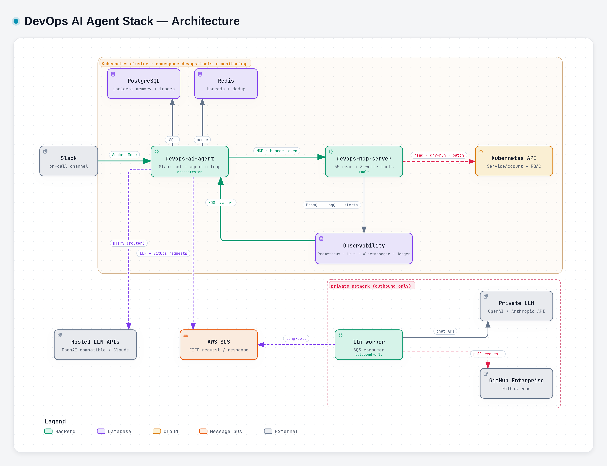

# DevOps AI Agent Stack

> ### Your first responder never sleeps.
> An AI on-call teammate that lives in Slack. It investigates every alert the way your best SRE would, explains the root cause with evidence, and proposes a fix that **you** approve.

**Status:** running in the `dev` cluster (namespace `devops-tools`) · **Audience:** everyone — on-call, engineers, leads.

---

## Background

Our services run on **Kubernetes** and are deployed declaratively with **Flux GitOps**. Health is watched by **Prometheus** (metrics), **Loki** (logs), **Jaeger** (traces) and **Alertmanager**, which turns a bad signal into an alert in **Slack**.

From there, an incident belongs to whoever is on call. The tooling to *detect* a problem is mature. What happens next is still almost entirely manual: one engineer, at any hour, turns an alert into an understanding of what broke and why, using five different tools.

---

## The problem

*A composite of the nights before the agent existed. The names are made up; the shape will be familiar.*

**01:44.** Dimas's phone buzzes on the nightstand. `UnexpectedErrorLog`, three alerts at once, on `checkout-gateway` and `storefront`. That is checkout, the path customers are paying through right now.

**01:47.** Laptop open, VPN connecting. Three alerts mean three notifications. Is it three problems or one? He starts with the dashboard, then remembers that this service's error panel lives on a different one.

**01:55.** `kubectl get pods` in one namespace, then the other. Some pods are restarting. `kubectl describe`, scroll, `kubectl logs`, scroll again. The error says something about an upstream, but which one?

**02:05.** *What changed?* He scrolls the deploy channel, then `git log` in the GitOps repo, then the HelmRelease history. Something was rolled out yesterday afternoon. Maybe that is it, maybe it is not.

**02:12.** He asks in the team channel: *"has anyone seen this before?"* The one person who fixed it last time is asleep, and what they learned lives in their head, not anywhere he can search.

**02:20.** Under pressure, he restarts the deployment. It changes nothing: the kubelet had already restarted those pods again and again. Now there is also an unreviewed change at 2 a.m. that nobody will remember making.

**02:40.** He finally finds it: one service is answering in a format the other no longer understands. He fixes it, watches the graphs settle, and goes back to bed at 03:10.

**The next morning,** nothing is written down. Three months later the same thing happens, to someone else, and they start again from zero.

### Why it hurts

| The pain | Where the time went |
|---|---|
| **Gathering, not thinking** | Most of the hour went to collecting pods, events, logs, metrics and recent changes, by hand, one tool at a time |
| **Noise** | Three alerts looked like three problems, and nothing tied them to one cause |
| **Knowledge in heads** | "Has this happened before?" depended on who was awake |
| **Risky fixes** | A change made under pressure: unreviewed, unaudited, and in this case useless |
| **No memory** | The lesson was lost the moment the incident closed |

None of this is about skill. It is about doing slow, repetitive work at the worst possible hour.

---

## Imagine if…

- **…the evidence was already gathered** by the time the phone buzzed: pods, events, logs, metrics, traces and recent changes.
- **…three alerts arrived as one incident**, because something had already worked out that they share a cause.
- **…"have we seen this before?" answered itself**, with the fix a teammate confirmed last quarter.
- **…a fix was already waiting for one click.** It had been checked, dry-run and explained. Or it had been honestly refused, because the evidence did not support it.
- **…the lesson survived the night**, and the next person started where this one finished.

---

## The solution

The **DevOps AI Agent Stack** is an AI teammate that sits in the on-call channel. It investigates every alert the way an experienced SRE would, writes it up as a structured Root Cause Analysis in the alert's own thread, and **never changes anything without a human's approval**.

| 🔎 **Investigates** | 🧠 **Remembers** | 🛡️ **Fixes safely** | 🧭 **Onboards** |
|---|---|---|---|
| Minutes from alert to a structured RCA, in the alert's own thread | Every incident, every confirmed cause, every fix that did or did not work | One fix at a time, dry-run first, executed only after a human clicks *Approve* | "Explain this cluster" answered from the live cluster, not from a stale wiki |

### Proof: the same kind of night, with the agent

*This one is real: the `dev` cluster on 2026-10-21, as recorded in the agent's logs.*

| Time | What happened |
|---|---|
| **01:44:05** | Alertmanager fires `UnexpectedErrorLog` — 3 alerts across `checkout-gateway` and `storefront`. The agent opens **one thread for the whole group**. |
| 01:44:08 | It gathers what changed recently and locates the GitOps overlay that defines the affected workloads. |
| 01:45:27 | It splits the work: **two sub-investigations run in parallel**, one per service, each testing its own hypothesis. |
| 01:46:06 | The first sub-investigation fires **9 tool calls at once**: Alertmanager, two workload lookups, error-rate PromQL, endpoints, error logs, pods, events, services. |
| 01:47:46 | Both sub-investigations report back, and the lead combines their verdicts. |
| **01:49:05** | **The RCA card is posted in Slack, 5 minutes after the alert**, with the evidence behind every claim. |
| 01:49:11 | It considers a fix. **A rolling restart is refused**: the kubelet had already restarted those pods 9 times, so a restart would change nothing. This is the 02:20 mistake from the story above, caught by code. |
| 01:49:16 | **An image change is refused too**: no evidence in the thread showed that the proposed image exists. Nothing was guessed and nothing was touched. |
| 01:49:17 | The alert had resolved while the RCA was being written, so the incident is **closed automatically**. |
| 01:52:30 | An engineer asks in the thread, *"coba tunjukin log terakhirnya"* ("show me the latest logs"). **The answer comes back in 65 seconds**, from 3 fresh tool calls. |

### Before and after

| | Before | With the agent |
|---|---|---|
| Evidence gathered | By hand, one tool at a time | Automatically, in parallel, before anyone is at a laptop |
| Three alerts | Three problems to untangle | One thread, one investigation |
| "Seen this before?" | Ask whoever is awake | Recalled from memory, with human-confirmed causes first |
| The restart | Made at 02:20, useless and unaudited | Refused by a gate, with the reason posted |
| The lesson | Lost by morning | `@agent learn` stores it for next time |

The fix that was **not** made matters as much as the RCA. The agent is built to say "no" when the evidence is not there.

The fix that was **not** made matters as much as the RCA. The agent is built to say "no" when the evidence is not there.

---

## Features

### 🔎 Investigate
- **Alert → RCA in Slack.** The card holds:
  - the root cause;
  - the evidence, with the tool that produced each fact;
  - the hypotheses that were ruled out;
  - recommended actions and impact;
  - read-only runbook commands;
  - recent changes;
  - a confidence level. **Low confidence pages on-call automatically.**
- **Parallel sub-investigations.** When one alert group spans several services, each service gets its own sub-investigation.
- **24 built-in playbooks**, for example OOMKilled, CrashLoopBackOff, ImagePullBackOff, high error rate, high latency, GitOps drift, certificate expiry and log alerts. They are chosen from the alert *and* from the evidence the agent finds along the way.
- **Conversational follow-ups** in the same thread: "show me the logs", "when did this start?".

### 🧠 Remember
- **Teach it once.** `@agent learn` stores the *human-confirmed* root cause, and the next recurrence starts from it.
- **Three tiers of memory, never mixed:**
  1. what a human confirmed;
  2. what the agent concluded before;
  3. what merely looks related.
- **Fixes remember their outcome.** "We restarted it last time and the alert stayed up" is something it reads, not something it rediscovers.
- **Change timeline.** Rollouts, Helm upgrades, ConfigMaps and Git commits from the last 24 hours, attached to every alert.

### 🛡️ Fix — safely
- **One proposal, from a short whitelist:** restart, set image, set resources, scale, delete one pod, roll back, back up and delete an orphan, Flux reconcile.
- **A chain of automated checks before a card even appears**, then a server-side dry-run, then a **human click**.
- **GitOps-aware.** For Flux-managed workloads, the fix becomes a **pull request** (or a revert PR) instead of a live patch that the next reconcile would undo.
- **Verified afterwards.** About 5 minutes after the change it posts `recovered`, `unchanged`, `worse` or `inconclusive`, and remembers the verdict.

### 🧭 Onboard and document
- **Cluster tour.** Inventory tables built from the cluster: request flow, what manages each workload, and where in Git to change it.
- **Postmortem draft** on request. The model writes the narrative; the timeline and the numbers come straight from the database.

### 📊 See and measure
- **Read-only dashboard:**
  - incidents, remediation verdicts and **LLM cost per incident**;
  - every safety gate's activity;
  - the cluster map;
  - what the agent remembers.
- **Every run recorded and replayable.** A change to the agent is tested against real past incidents before it ships.

---

---

## Safe by design

1. **The investigator cannot write.** Write tools are invisible to the model that investigates, and refused if it calls one anyway.
2. **Code checks, not just prompts.** Missing evidence, unread logs, a fabricated claim, a mutating command in the runbook — each is caught by a deterministic gate, not by asking the model nicely.
3. **A human decides.** Every change needs an approver's click in Slack. Cards expire after 15 minutes, and a double click can never run a change twice.
4. **Your data stays yours.** IPs, hostnames, ARNs and emails are masked before any LLM sees a request. Secrets are never read. GitHub credentials never leave the private network.
5. **Cluster text is treated as data.** A log line that tries to give the agent instructions is framed as evidence, never obeyed.

---

## Works with your stack

| Area | What it connects to |
|---|---|
| Chat | **Slack**: Socket Mode, no public URL needed |
| Alerts | **Alertmanager** webhook, grouped by `alertname` + `namespace` |
| Platform | **Kubernetes** (k3s in dev), **Flux** GitOps, **Helm** |
| Observability | **Prometheus**, **Loki**, **Alertmanager**, **Jaeger** or **Tempo** |
| LLMs | **Claude**, any **OpenAI-compatible** API, or a **private LLM** inside your network over AWS SQS. A router can use several at once with automatic failover. |
| Source control | **GitHub Enterprise**: pull requests and revert PRs for GitOps fixes |
| Storage | **PostgreSQL** (long-term memory), **Redis** (conversation memory) |

## How it fits together

*Diagram made with archify. Interactive version: `diagrams/architecture/architecture.html`; vector: `diagrams/architecture/architecture.svg`.*

| Component | Repository | Role |
|---|---|---|
| **devops-ai-agent** | `devops-ai-agent` | The brain: Slack bot, alert intake, investigation loop, safety gates, remediation, dashboard |
| **devops-mcp-server** | `devops-mcp-server` | The hands: 55 read-only tools and 8 guarded write tools over the Model Context Protocol |
| **llm-worker** | `devops-ai-agent-worker` | The bridge into the private network: private LLM and GitHub Enterprise, outbound-only |
| **Helm chart** | `devops-ai-helm-charts` | One release for all three, refusing to render if their shared settings disagree |
| **GitOps manifests** | `gitops-devops-ai-manifest` | Flux + Kustomize, the source of truth for each cluster |
| **Sample apps** | `devops-sample-apps` | A four-service checkout stack with fault switches, used to rehearse and benchmark incidents |

## By the numbers

| | |
|---|---|
| **63** | tools the agent can use (55 read-only, 8 write) |
| **24** | built-in playbooks for specific failure modes |
| **8** | whitelisted remediation actions, each reversible or backed up first — no generic "run anything" |
| **4** | LLM backends in the dev router today (2 hosted, 2 private) |
| **15 min** | lifetime of an approval card |
| **~5 min** | from an approved fix to its verified verdict |

## Roadmap

| | Item | Status |
|---|---|---|
| ✅ | Multi-cluster, part 1: an SQS bridge, so a cluster with no inbound network access can still be investigated | Done |
| 🚧 | Multi-cluster, part 2: each investigation runs against the right cluster, and incidents and memory carry a `cluster` label | In design; a staging cluster is being set up to validate it |
| 🗓️ | Multi-cluster, part 3: chart-managed bridges per cluster | Planned |

## Read next

| If you want to… | Read |
|---|---|
| use the agent in Slack | **Slack User Guide** |
| understand the moving parts | **Architecture** |
| know exactly what happens after an alert | **How an Investigation Works** |
| review what it may change, and every check in front of it | **Remediation and Safety Guardrails** |
| deploy or configure it | **Deployment and Configuration** |
| run it day to day | **Operations Guide** |

## Glossary

| Term | Meaning |
|---|---|
| **RCA** | Root Cause Analysis — the structured answer the agent posts for an incident |
| **MCP** | Model Context Protocol — the standard protocol the agent uses to discover and call tools |
| **Tool** | One operation such as `k8s_list_pods` or `prometheus_query`; read-only, unless it is a write behind approval |
| **Gate** | A deterministic check in code that can hold, rewrite or refuse what the model produced |
| **Playbook** | A Markdown guide for one kind of failure, loaded into the model's context when the symptom matches |
| **Light / heavy route** | The LLM router's two tiers: a cheap model for casual questions, a strong one for alerts and fixes |
| **Approval card** | The Slack message with *Approve / Reject* buttons that every change must pass through |
