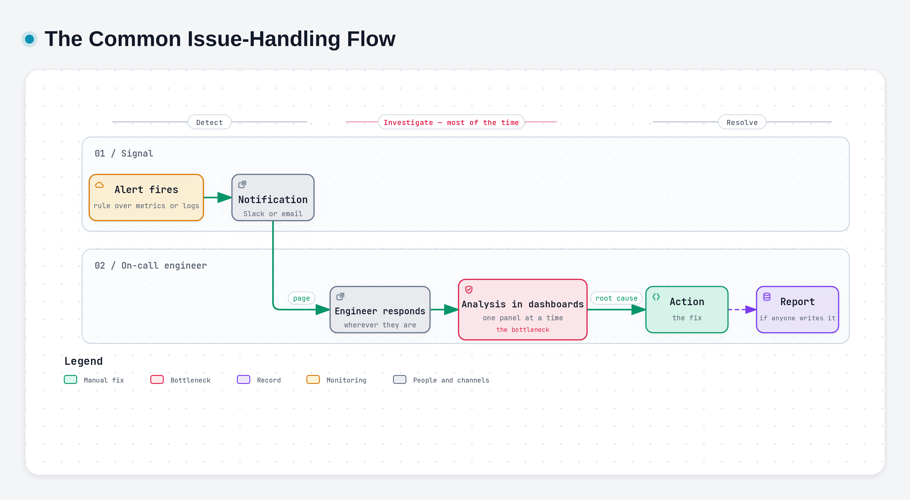
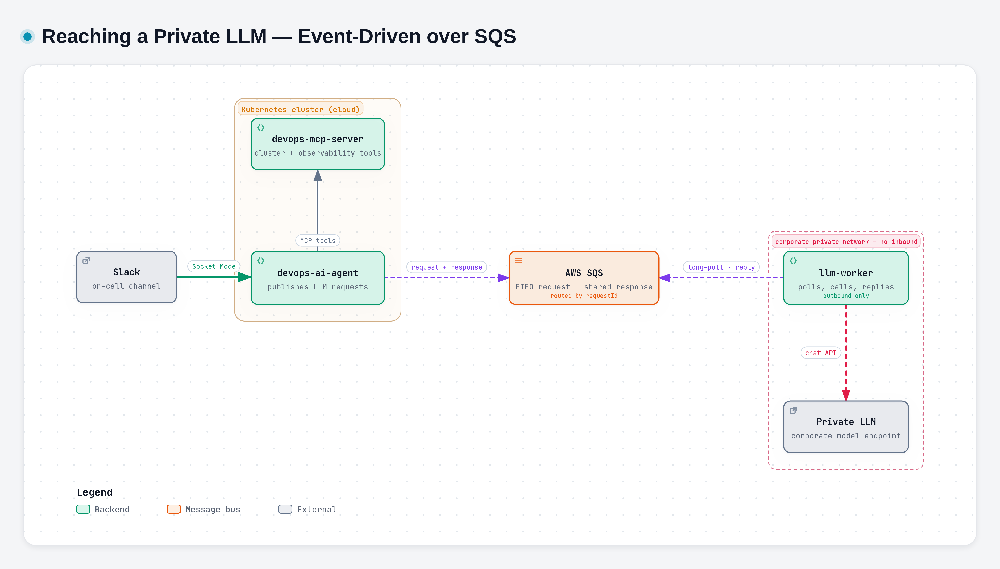

# DevOps AI Agent Stack

> ### Your first responder never sleeps.
> An AI on-call teammate that lives in Slack. It investigates every alert the way your best SRE would, explains the root cause with evidence, and proposes a fix that **you** approve — from your phone, wherever you are.

**Author:** Ahmad Naoval Annasik, DevOps Engineer · **Audience:** everyone — on-call, engineers, leads.

---

## Background

### Observability: designed in, or bolted on?

Every phase of the software development life cycle feeds the next: planning, requirements, design, development, testing, deployment, maintenance. Observability *should* start at design. In practice it is usually added after deployment, once something has already gone wrong. It turns into tech debt for four familiar reasons:

| Reason | What it sounds like |
|---|---|
| **No visible feature value** | It does not show up in a product demo. |
| **Deadline pressure** | Ship first, monitor later. |
| **Works fine until it doesn't** | The need only appears during an incident. |
| **No clear owner** | Dev thinks it is Ops. Ops thinks it is Dev. |

### What observability gives us

**Observability** is the ability to understand what is happening inside a system by analysing the data it produces. Monitoring tells us *that* something is wrong; observability helps us understand *why* it happened and *where* it started. In a distributed environment like Kubernetes, it lets engineers ask questions of the system instead of guessing.

It rests on four pillars:

| Pillar | What it is | What it tells us | Common choice |
|---|---|---|---|
| **Metrics** | Numeric time series (a value, a timestamp, labels), cheap to store and fast to query | *Something is wrong*: CPU, memory, latency, error rate, storage | Prometheus |
| **Logs** | Timestamped records of events, with severity, source and message | *What happened*: the detailed story behind an issue | Loki (shipped by Fluent Bit) |
| **Traces** | The end-to-end journey of one request, made of spans with durations | *Where it happened*: where the time went and where it failed | Jaeger / Tempo |
| **Alerts** | Rules evaluated over metrics or logs, with a severity and a destination | *Someone needs to act*: the bridge from detection to response | Alertmanager → Slack |

Together these make a **common minimum standard** for observability on Kubernetes: Prometheus for metrics, Loki with Fluent Bit for logs, Jaeger or Tempo for traces, and Alertmanager routing to Slack, with workloads delivered by GitOps (Flux). It is the stack the agent is built to work with.

> **We have all the data. But who connects the dots?**
> When an alert fires, an engineer still opens every panel, matches the timestamps, and pieces the story together by hand.

---

## The problem

### The common issue-handling flow

*Diagram made with archify. Interactive version: `diagrams/issue-flow/issue-flow.html`.*

### A night on call

> *"Incidents never happen at your desk. They happen at dinner, in traffic, or in bed."*

*An illustrative scenario, but the shape will be familiar to anyone who has carried the pager.*

| Time | What happens |
|---|---|
| **03:13** | The alert fires: *"High error rate on payment-service"*. |
| 03:20 | The on-call engineer is at a laptop and opens Grafana. It starts from the dashboard. |
| 03:35 | Metrics, then logs, then Kubernetes events, matching timestamps by hand across panels. |
| **03:58** | Root cause found: a pod was OOMKilled after a config change. |
| 04:05 | Fix deployed; the error rate is back to normal. |

**Investigation: 38 minutes. Fix: 7 minutes.** More than 80% of the incident was spent *finding* the problem, not fixing it. The next morning nothing is written down, and the next time it happens someone else starts from zero.

### Why it hurts

| Challenge | What it costs |
|---|---|
| **Manual correlation** | Metrics, logs, traces and Kubernetes events are matched one by one, even when they sit on one dashboard |
| **High MTTR** | Most of the time to resolve goes to investigation, not to the fix |
| **Knowledge dependency** | How fast an issue is analysed depends on who knows the system — hard for new joiners, harder at 3 a.m. |
| **Alert fatigue** | A high alert volume buries the important ones and slows the response |
| **Risky fixes** | Changes made under pressure are unreviewed and unaudited |
| **No memory** | The lesson is lost the moment the incident closes |

None of this is about skill. It is about doing slow, repetitive work at the worst possible hour.

---

## Imagine if…

- **…you could answer the page from your phone**: read the cause, ask for the logs and approve the fix in Slack, without opening a laptop or rushing back to your desk.
- **…the evidence was already gathered** by the time the phone buzzed: pods, events, logs, metrics, traces and recent changes.
- **…three alerts arrived as one incident**, because something had already worked out that they share a cause.
- **…"have we seen this before?" answered itself**, with the fix a teammate confirmed last quarter.
- **…a fix was already waiting for one click.** It had been checked, dry-run and explained. Or it had been honestly refused, because the evidence did not support it.
- **…the lesson survived the night**, and the next person started where this one finished.

---

## The solution

The **DevOps AI Agent Stack** makes that real: an AI teammate that sits in the on-call channel. It investigates every alert the way an experienced SRE would, writes it up as a structured Root Cause Analysis in the alert's own thread, and **never changes anything without a human's approval**. It is an AI-powered assistant inside the flow a team already has, not a replacement for it.

Because it lives in Slack, it goes wherever Slack goes. **The on-call engineer can work an incident from the Slack mobile app**: no laptop, no VPN, no kubeconfig on the device.

| 📱 **Anywhere** | 🔎 **Investigates** | 🧠 **Remembers** | 🛡️ **Fixes safely** | 🧭 **Onboards** |
|---|---|---|---|---|
| The whole incident from Slack on your phone, no laptop needed | Minutes from alert to a structured RCA, in the alert's own thread | Every incident, every confirmed cause, every fix that did or did not work | One fix at a time, dry-run first, executed only after a human clicks *Approve* | "Explain this cluster" answered from the live cluster, not from a stale wiki |

### Goals

| # | Goal | What it means |
|---|---|---|
| 01 | **Faster time to root cause** | Every alert becomes an evidence-based RCA in Slack within minutes, not after manual digging in Grafana |
| 02 | **Automated correlation** | Metrics, logs, traces and cluster state are connected automatically — the step engineers still did by hand |
| 03 | **Fit the existing workflow** | Works inside Slack and the standard observability stack, on desktop and mobile alike |
| 04 | **Safe for remediation** | Every change is dry-run, human-approved, audited and verified |
| 05 | **Enterprise-ready** | Runs in your own infrastructure, follows your security policy, and can use a private LLM |
| 06 | **Learn from every incident** | Past RCAs and confirmed fixes are reused, so recurring issues are resolved faster |

### Before and after

| | Before | With the agent |
|---|---|---|
| Where you respond | At a laptop, on VPN, with Grafana and kubectl open | Anywhere, from Slack on your phone |
| Evidence gathered | By hand, one panel at a time | Automatically, in parallel, before anyone is at a laptop |
| Related alerts | Separate problems to untangle | One thread, one investigation |
| "Seen this before?" | Ask whoever is awake | Recalled from memory, with human-confirmed causes first |
| The fix | Applied by hand after the digging, unreviewed | Proposed with evidence, dry-run and approved — or refused by a gate, with the reason posted |
| The lesson | Lost by morning | `@agent learn` stores it for next time |

The fix that was **not** made matters as much as the RCA. The agent is built to say "no" when the evidence is not there.

---

## See it in action

A table of *before* and *after* is a claim. Here is what it looks like on a night like the one in *A night on call*: one alert, worked end to end from a phone.

### 1. The alert arrives, and the answer is already there
The phone buzzes. By the time the thread is open, the agent has read the pods, events, logs, metrics and recent changes, and posted its RCA.

> 🖼️ **Screenshot:** `images/demo-01-rca-mobile.png`. Slack mobile: the alert thread with the RCA card (root cause, evidence, confidence, recent changes).

### 2. Ask, without opening a laptop
Something in the RCA needs a closer look. Instead of a VPN, Grafana and `kubectl`, the engineer types a question into the thread.

> 🖼️ **Screenshot:** `images/demo-02-follow-up.png`. A follow-up such as *"show me the latest logs"* and the agent's answer in the same thread.

### 3. One tap to fix, and proof that it worked
The agent proposes one fix, already dry-run. The engineer approves it with one tap on the phone, and about five minutes later the agent reports whether it helped.

> 🖼️ **Screenshot:** `images/demo-03-approval.png`. The approval card with *Approve* / *Reject*, then the verification verdict (`recovered`).

### 4. The GitOps way, when the workload lives in Git
For a Flux-managed workload the fix does not touch the cluster. The card shows the Git diff, and approving opens a pull request.

> 🖼️ **Screenshot:** `images/demo-04-gitops-pr.png`. The card with the diff, and the pull request it opened.

### 5. The morning after
The incident is closed, the lesson is stored with `@agent learn`, and the dashboard shows what happened, what it cost and which gates fired.

> 🖼️ **Screenshot:** `images/demo-05-dashboard.png`. The dashboard: incident list, remediation verdicts and LLM cost.

### Demo videos

| Scenario | What you do | What the agent does | Video |
|---|---|---|---|
| **Ask, investigate, follow up** | *"Check the logs of the storefront service"*, then *"Why is it failing?"* | Reads logs, metrics and pod status, then answers the follow-up in the same thread | 🎬 *add link* |
| **Guarded remediation** | *"List the deployments in namespace sample-apps"*, pick one, then *"Restart it"* | Dry-runs the restart first, then posts an approval card. You approve with one tap on your phone, and it verifies the result. | 🎬 *add link* |
| **Fix the GitOps way** | *"Scale storefront to 3 replicas"* | Sees that the workload is Flux-managed, so it does not touch the cluster directly. The card shows the Git diff; approving opens a PR, and Flux rolls it out after the merge. | 🎬 *add link* |

Every step above comes from a feature that works the same way for every alert. The next section walks through them one by one.

---

## Features

What made that night short, feature by feature.

### 📱 Respond from anywhere
The agent is not a desktop tool. Everything happens in Slack, so **the Slack mobile app is a full on-call console**:
- **Read the RCA** the moment the alert fires: cause, evidence, confidence and recent changes, in the alert's thread.
- **Look at the cluster by asking.** *"Show me the logs"*, *"which pods are restarting?"*, *"what changed in the last hour?"*: the agent runs the queries and answers in the thread.
- **Approve or reject the fix with one tap.** The same approver list, dry-run and 15-minute expiry apply on a phone as on a desk.
- **Nothing to install or carry.** Cluster access is held centrally by the agent; the phone never needs a VPN, a kubeconfig or Grafana.

Incidents happen at dinner, in traffic or in bed. The first response no longer waits until someone is back at a desk.

### 🔎 Investigate
- **Alert → RCA in Slack.** The card holds:
  - the root cause;
  - the evidence, with the tool that produced each fact;
  - the hypotheses that were ruled out;
  - recommended actions and impact;
  - read-only runbook commands;
  - recent changes;
  - a confidence level. **Low confidence pages on-call automatically.**
- **Parallel sub-investigations.** When one alert group spans several services, each service gets its own sub-investigation.
- **24 built-in playbooks**, for example OOMKilled, CrashLoopBackOff, ImagePullBackOff, high error rate, high latency, GitOps drift, certificate expiry and log alerts. They are chosen from the alert *and* from the evidence the agent finds along the way.
- **Conversational follow-ups** in the same thread: "show me the logs", "when did this start?".

### 🧠 Remember
- **Teach it once.** `@agent learn` stores the *human-confirmed* root cause, and the next recurrence starts from it.
- **Three tiers of memory, never mixed:**
  1. what a human confirmed;
  2. what the agent concluded before;
  3. what merely looks related.
- **Fixes remember their outcome.** "We restarted it last time and the alert stayed up" is something it reads, not something it rediscovers.
- **Change timeline.** Rollouts, Helm upgrades, ConfigMaps and Git commits from the last 24 hours, attached to every alert.

### 🛡️ Fix — safely
- **One proposal, from a short whitelist:** restart, set image, set resources, scale, delete one pod, roll back, back up and delete an orphan, Flux reconcile.
- **A chain of automated checks before a card even appears**, then a server-side dry-run, then a **human click**.
- **GitOps-aware.** For Flux-managed workloads, the fix becomes a **pull request** (or a revert PR) instead of a live patch that the next reconcile would undo.
- **Verified afterwards.** About 5 minutes after the change it posts `recovered`, `unchanged`, `worse` or `inconclusive`, and remembers the verdict.

### 🧭 Onboard and document
- **Cluster tour.** Inventory tables built from the cluster: request flow, what manages each workload, and where in Git to change it.
- **Postmortem draft** on request. The model writes the narrative; the timeline and the numbers come straight from the database.

### 📊 See and measure
- **Read-only dashboard:**
  - incidents, remediation verdicts and **LLM cost per incident**;
  - every safety gate's activity;
  - the cluster map;
  - what the agent remembers.
- **Every run recorded and replayable.** A change to the agent is tested against real past incidents before it ships.

---|---|---|
| **Ask, investigate, follow up** | *"Check the logs of the storefront service"*, then *"Why is it failing?"* | Reads logs, metrics and pod status, then answers the follow-up in the same thread |
| **Guarded remediation** | *"List the deployments in namespace sample-apps"*, pick one, then *"Restart it"* | Dry-runs the restart first, then posts an approval card. You approve with one tap on your phone, and it verifies the result. |
| **Fix the GitOps way** | *"Scale storefront to 3 replicas"* | Sees that the workload is Flux-managed, so it does not touch the cluster directly. The card shows the Git diff; approving opens a PR, and Flux rolls it out after the merge. |

---

## Safe by design

1. **The investigator cannot write.** Write tools are invisible to the model that investigates, and refused if it calls one anyway.
2. **Code checks, not just prompts.** Missing evidence, unread logs, a fabricated claim, a mutating command in the runbook — each is caught by a deterministic gate, not by asking the model nicely.
3. **A human decides.** Every change needs an approver's click in Slack. Cards expire after 15 minutes, and a double click can never run a change twice.
4. **Your data stays yours.** IPs, hostnames, ARNs and emails are masked before any LLM sees a request. Secrets are never read. GitHub credentials never leave the private network.
5. **Cluster text is treated as data.** A log line that tries to give the agent instructions is framed as evidence, never obeyed.

---

## Using a private LLM

A public LLM is not always an option. In many organisations the approved LLM sits **inside** the corporate network while the services run **outside** it. How do they talk?

| Option | How it works | Verdict |
|---|---|---|
| **Expose the MCP server** | The private side calls into the cluster | Needs an inbound path that a security review must own |
| **Tunnelling** | A long-lived tunnel between the two networks | One more critical component to operate and audit |
| **Direct connect** | A dedicated network link | Slow to approve, costly, and over-built for a request/response workload |
| **Event-driven** ✅ | Both sides talk only **outbound**, to AWS SQS | **Chosen.** No inbound exception on either network. |

*Diagram made with archify. Interactive version: `diagrams/private-llm/private-llm.html`.*

The agent publishes each LLM request to an SQS FIFO queue. The **llm-worker**, inside the private network, long-polls it, calls the private model, and publishes the answer to a shared response queue, where the agent matches it by `requestId`. The **LLM router** can mix this private backend with hosted ones (Claude, OpenAI-compatible) and fail over between them. Credential-like identifiers are masked before any request leaves the agent.

---

## Works with your stack

| Area | What it connects to |
|---|---|
| Chat | **Slack**: Socket Mode, no public URL needed |
| Alerts | **Alertmanager** webhook, grouped by `alertname` + `namespace` |
| Platform | **Kubernetes**, **Flux** GitOps, **Helm** |
| Observability | **Prometheus**, **Loki**, **Alertmanager**, **Jaeger** or **Tempo** |
| LLMs | **Claude**, any **OpenAI-compatible** API, or a **private LLM** inside your network over AWS SQS. A router can use several at once with automatic failover. |
| Source control | **GitHub Enterprise**: pull requests and revert PRs for GitOps fixes |
| Storage | **PostgreSQL** (long-term memory), **Redis** (conversation memory) |

### Tech stack

| Layer | Built with |
|---|---|
| Agent core | Node.js, TypeScript, Slack Bolt, MCP SDK |
| AI / LLM | Anthropic SDK, OpenAI SDK, AWS SQS (private LLM path) |
| Observability | Kubernetes, Prometheus, Alertmanager, Loki, Tempo, Jaeger |
| Data | PostgreSQL, Redis |
| Dashboard | React, Tailwind CSS, React Flow |
| Delivery | Docker, GitHub Actions, Helm, Flux CD |
| Built with | Claude Code, guided by SDLC practice and a DevOps engineer's point of view |

## How it fits together

*Diagram made with archify. Interactive version: `diagrams/architecture/architecture.html`; vector: `diagrams/architecture/architecture.svg`.*

| Component | Repository | Role |
|---|---|---|
| **devops-ai-agent** | `devops-ai-agent` | The brain: Slack bot, alert intake, investigation loop, safety gates, remediation, dashboard |
| **devops-mcp-server** | `devops-mcp-server` | The hands: 55 read-only tools and 8 guarded write tools over the Model Context Protocol |
| **llm-worker** | `devops-ai-agent-worker` | The bridge into the private network: private LLM and GitHub Enterprise, outbound-only |
| **Helm chart** | `devops-ai-helm-charts` | One release for all three, refusing to render if their shared settings disagree |
| **GitOps manifests** | `gitops-devops-ai-manifest` | Flux + Kustomize, the source of truth for each cluster |
| **Sample apps** | `devops-sample-apps` | A four-service checkout stack with fault switches, used to rehearse and benchmark incidents |

## By the numbers

| | |
|---|---|
| **63** | tools the agent can use (55 read-only, 8 write) |
| **24** | built-in playbooks for specific failure modes |
| **8** | whitelisted remediation actions, each reversible or backed up first — no generic "run anything" |
| **15 min** | lifetime of an approval card |
| **~5 min** | from an approved fix to its verified verdict |

## Scope

| | |
|---|---|
| **Personal initiative** | Built on personal time and resources |
| **Built with Claude Code** | "Vibe coded", but guided by SDLC best practice and reviewed from a DevOps engineer's point of view |
| **Focused scope** | Kubernetes observability at the **infrastructure** level, not yet at the application-code level |
| **Built for real workflows** | Designed around common incident-handling use cases and the security policies enterprises work under |

## Read next

| If you want to… | Read |
|---|---|
| use the agent in Slack | **Slack User Guide** |
| understand the moving parts | **Architecture** |
| know exactly what happens after an alert | **How an Investigation Works** |
| review what it may change, and every check in front of it | **Remediation and Safety Guardrails** |
| deploy or configure it | **Deployment and Configuration** |
| run it day to day | **Operations Guide** |

## Glossary

| Term | Meaning |
|---|---|
| **RCA** | Root Cause Analysis — the structured answer the agent posts for an incident |
| **MCP** | Model Context Protocol — the standard protocol the agent uses to discover and call tools |
| **Tool** | One operation such as `k8s_list_pods` or `prometheus_query`; read-only, unless it is a write behind approval |
| **Gate** | A deterministic check in code that can hold, rewrite or refuse what the model produced |
| **Playbook** | A Markdown guide for one kind of failure, loaded into the model's context when the symptom matches |
| **Light / heavy route** | The LLM router's two tiers: a cheap model for casual questions, a strong one for alerts and fixes |
| **Approval card** | The Slack message with *Approve / Reject* buttons that every change must pass through |
