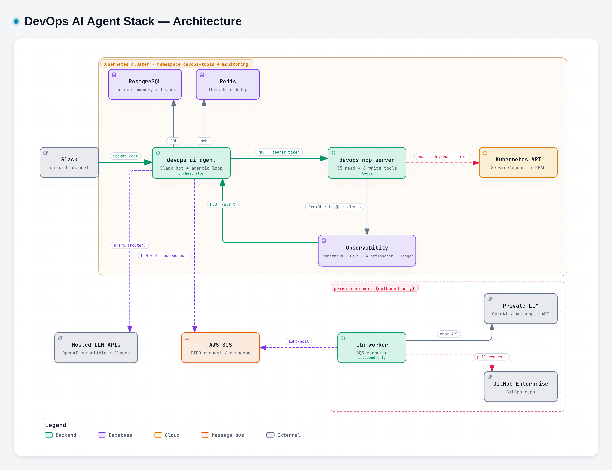

# Architecture

> **Audience:** engineers. Parent: *DevOps AI Agent Stack — Overview*.

## Components

The stack is three services, each with one job. Splitting them this way keeps cluster access, LLM access and Slack access in separate processes with separate credentials.

### devops-ai-agent (the orchestrator)
A Node.js 26 / TypeScript service. One process holds:
- **Slack integration** (Bolt, Socket Mode — outbound WebSocket, no public URL needed): mentions, ✅ reactions, approval buttons. Everything is plain Slack messages and Block Kit buttons, so it works the same in the desktop and the mobile app.
- **Alertmanager webhook** `POST /alert` (bearer-token protected). It answers `200` at once and investigates in the background.
- **Investigation loop**: builds the context, calls the LLM, executes tool calls in parallel, and runs the gates.
- **Remediation flow**: proposal → gate chain → dry-run → approval card → execution → verification poller.
- **Incident lifecycle**: stores RCAs, handles resolved alerts, runs a sweeper for resolves that never arrived, and handles `learn`, `postmortem` and status commands.
- **Dashboard**: a read-only second HTTP listener (port `3001`).
- **Readiness** `GET /health`: `503` when MCP, Postgres or Redis is unreachable.

### devops-mcp-server (the tools)
An MCP server over HTTP (`/mcp`, bearer token), stdio, or SQS (`TRANSPORT=sqs`, for a cluster that accepts no inbound traffic). It is the only component that talks to the Kubernetes API and the observability backends. Tools are **auto-discovered** by the agent: a new tool needs no agent change.

The 66 tools by domain:

| Domain | Count | Examples |
|---|---|---|
| Kubernetes | 37 | `k8s_cluster_health`, `k8s_cluster_inventory`, `k8s_change_timeline`, `k8s_correlate_pods`, `k8s_describe_pod`, `k8s_get_pod_logs` |
| Prometheus | 6 | `prometheus_query`, `prometheus_query_range`, rules, targets |
| Alertmanager | 1 | `alertmanager_get_alerts` — the only source of truth for "what is firing" |
| Loki | 6 | `loki_query`, `loki_query_range`, labels, streams |
| Tracing | 3 | `tracing_search`, `tracing_get_trace` (Tempo or Jaeger) |
| Capacity | 2 | `k8s_find_unused_resources`, `k8s_recommend_resources` |
| **Write** | 11 | `k8s_rollout_restart`, `k8s_set_image`, `k8s_set_resources`, `k8s_scale`, `k8s_delete_pod`, `k8s_delete_orphan`, `k8s_rollout_undo`, `flux_reconcile`, and for nodes `k8s_cordon`, `k8s_uncordon`, `k8s_drain`. Registered only with `MCP_ENABLE_WRITE_TOOLS=true`; the workload ones are limited to `ALLOWED_REMEDIATION_NAMESPACES` |

An empty result is always **explained** (for example `noLogLines: true` with a verdict), never a bare `[]`. This keeps "the query was wrong" distinguishable from "nothing happened".

Every tool result has its **secret values masked** before it leaves the server: env values and keys named like secrets, the value after a `--token` or `--password` argument, and token-shaped text such as JWTs and Bearer headers. Secret names and references are kept, because the agent reasons about them.

### llm-worker (the private-network bridge)
An SQS consumer that runs **inside the private network** and needs **outbound access to AWS SQS only**. It bridges two things:
1. **Agent → private LLM.** It speaks OpenAI `/v1/chat/completions`, Anthropic `/v1/messages`, or an agent-builder (Langflow) run endpoint. It translates content blocks natively and never stringifies them.
2. **Agent → GitHub Enterprise**, for the GitOps PR flow (`dry_run`, `open_pr`, `history`, `revert_pr`, `locate`). The worker holds the GitHub credentials (a PAT or a GitHub App); the agent holds none.

It drains gracefully on SIGTERM, sends poison messages to a DLQ, and processes requests concurrently (`SQS_MAX_CONCURRENCY`).

## Deployment topology

Where each component runs, and which way each connection goes:

*Diagram made with archify. Interactive version: `diagrams/architecture/architecture.html`; vector: `diagrams/architecture/architecture.svg`.*

How to read the diagram:
- **Alertmanager → agent.** An alert arrives as a webhook on `POST /alert`.
- **Agent ⇄ Slack.** Over Socket Mode, an outbound WebSocket, so the agent needs no public URL.
- **Agent → MCP server → cluster and backends.** Every read of Kubernetes, Prometheus, Loki, Alertmanager or Jaeger goes through the MCP server.
- **Agent → LLMs.** Hosted backends are called directly. A private LLM is reached through SQS and the llm-worker.
- **Agent → Postgres and Redis.** Long-term incident memory and short-term conversation memory.
- **llm-worker → GitHub Enterprise.** Pull requests for GitOps fixes, from inside the private network.
- **More than one cluster.** `dev` is the central cluster: it runs the agent stack and the observability it queries. A workload cluster (`stg`) ships its metrics and logs to dev, labelled `cluster=stg`, and the agent reaches its Kubernetes by calling the `devops-mcp-server` running there over HTTP across the LAN (in production, a peered network), which also carries the approved fixes. A cluster that accepts no inbound traffic can use an SQS bridge (`TRANSPORT=sqs`) instead. GitOps pull requests for stg edit stg's own overlay (`apps/stg/...`) in the same repository. Every thread, card and incident belongs to one cluster, shown on the RCA and approval cards.

Everything is deployed by **Flux** from `gitops-devops-ai-manifest`. The three services ship as **one Helm release** (`devops-ai-stack` umbrella chart), in namespace `devops-tools`.

## Data stores

The agent keeps state in two stores, each for a different kind of memory:

| Store | What it holds | Lifetime |
|---|---|---|
| **Postgres** | `incidents` (RCA, labels, change timeline, parent/child correlation), `incident_feedback` (human-confirmed causes), `remediations` (proposal, approval, result, backup), `remediation_checks` (verification due dates and verdicts), `llm_usage` (tokens per call and backend), `agent_events` (the full trace of every run), `postmortems` | Durable. The schema is applied by versioned migrations at pod startup (advisory-locked). |
| **Redis** | `conv:*` conversation history per Slack thread, `rca:*` "RCA already sent" flag, `skills:*` the playbooks a thread carries, `dedup:*` alert fingerprints, `inflight:*` alert investigations still running, so every replica can correlate against them, `threadlock:*` which replica is running a thread's turn, so one conversation never runs on two pods at once | 24h conversation TTL; 12h dedup claims; 15m in-flight entries; 60s renewed thread leases |

Conversation memory (Redis) and incident memory (Postgres) are deliberately separate: one is a short-lived cache, the other is the agent's long-term memory.

## Cross-service contracts

These are the interfaces where a change on one side breaks the other. They must change on both sides together.

| Contract | Transport | Shape (summary) |
|---|---|---|
| agent ↔ mcp-server | MCP over HTTP, `Authorization: Bearer <MCP_AUTH_TOKEN>` | Standard MCP `listTools` / `callTool`. Write tools carry a `[WRITE]` description prefix. |
| agent ↔ llm-worker (LLM) | SQS FIFO: `llm-request.fifo` → shared `llm-response.fifo` | `{ requestId, messages, tools, systemPrompt, traceId? }` → `{ requestId, response \| error }`. Routed by `requestId`. |
| agent ↔ llm-worker (GitOps) | SQS FIFO: `gitops-request.fifo` → the same shared response queue | `{ requestId, op: dry_run \| open_pr \| history \| revert_pr \| locate, … }`. A refusal can carry `drift` (the repo and the cluster disagree). |
| agent ↔ mcp-server (SQS bridge) | SQS FIFO: `devops-mcp-<cluster>-request.fifo` → dedicated `devops-mcp-response.fifo` | `{ requestId, op: list_tools \| call_tool, tool?, args?, deadline, traceId? }` → `{ requestId, response \| error }`. For a cluster with no inbound traffic. A request past its `deadline` is never run; the agent never retries. |

With tracing on, all three SQS contracts also carry the OpenTelemetry context as message attributes (`traceparent`, `tracestate`). The message bodies are unchanged, so a consumer that ignores the attributes still works.

`traceId` is the Slack thread id. One `grep <thread-id>` therefore joins the agent log, the llm-worker log and the Slack thread.

## LLM routing

The agent can use several LLMs at once and choose per call, trading cost against quality. With `LLM_PROVIDER=router` the agent holds several backends and picks one per call:
- **light route** — plain Slack mentions and formatting backstops;
- **heavy route** — alerts, explicit investigation requests, remediation proposals.

Failover is **up-only** (light → heavy, never the reverse), because a weak model fails by answering confidently, not by throwing an error. A backend that fails repeatedly is skipped for a cool-off. Only backends of kind `private-llm` use the SQS path; `claude` and `openai-compatible` backends are called directly.
