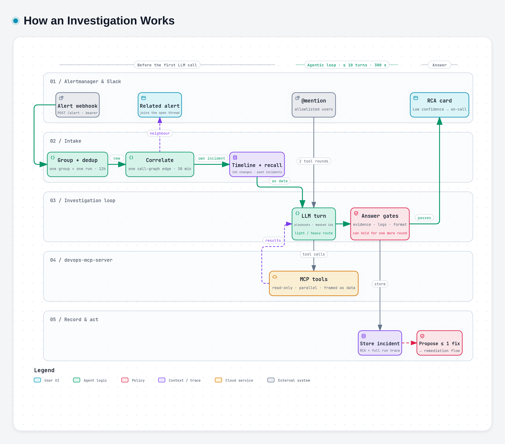

# How an Investigation Works

> **Audience:** engineers; the first two sections are readable by anyone. Parent: *DevOps AI Agent Stack — Overview*.

## The pipeline

*Diagram made with archify. Interactive version: `diagrams/investigation/investigation.html`; vector: `diagrams/investigation/investigation.svg`.*

In short:
1. **Group** — one webhook is one Alertmanager group, and one group is ONE investigation.
2. **Dedup** — the fingerprint is claimed for 12h (atomically in Redis across pods).
3. **Correlate** — a neighbour of an open incident joins that incident's thread.
4. **Context** — the change timeline (24h) and incident memory recall.
5. **Loop** — LLM ⇄ MCP tools, with parallel calls and per-symptom playbooks.
6. **Gates** — deterministic checks on the answer before it leaves.
7. **Post** — the RCA card in Slack; Low confidence pages on-call.
8. **Store** — the incident row in Postgres and the full trace in `agent_events`.
9. **Propose** — at most one fix; see *Remediation and Safety Guardrails*.

## 1–3. Entry, grouping, dedup and correlation

- **Asynchronous webhook.** `/alert` returns `200` immediately and the investigation runs in the background, so Alertmanager never times out and retries.
- **One group, one thread.** Alertmanager is configured with `group_by: [alertname, namespace]`. Ten crash-looping pods of one alert become one thread, one investigation and one approval card. The group's text lists the distinct services and pods it covers.
- **Deduplication.** The same alert group is processed once per 12 hours. A *resolved* webhook releases the claim, so the next real firing gets a fresh investigation.
- **Cross-alert correlation.** Suppose a new alert group's service is the same as, or one call-graph edge away from, an unresolved incident in the same namespace that started within the last 30 minutes. The call graph comes from `http_client_requests_total{service,peer}`. In that case the alert is posted as **🔗 Related alert** into the existing thread instead of opening a new one. It is stored as a child of that incident and gets no card of its own. Any failure here falls back to the normal path.
- **Mentions** are accepted from `SLACK_ALLOWED_USERS`, plus the on-call and approver users; anyone else gets an ephemeral refusal. An empty allowlist lets anyone in a channel the bot is in, with a warning at boot.

## 4. Context before the first LLM call

- **Change timeline.** What changed in the namespace during the last 24 hours: workload rollouts (with the pod-template diff), HelmRelease upgrades, ConfigMap changes and GitOps commits. It goes to the model as data and onto the RCA card as **🕑 Recent changes**. A source that could not be read is shown as *unknown*, never as "no changes".
- **Incident memory recall**, in three trust tiers that are never merged:
  1. **Human-confirmed** causes from `@agent learn` — injected first, as a strong prior to check.
  2. **The agent's own past RCAs** for the same alert and namespace — "verify before reuse".
  3. **Possibly related** incidents whose recorded root cause shares wording with this alert (Postgres full-text search) — a lead, never an explanation.

  Past **remediations with their verdicts** are recalled too. A fix that did not work comes back as a negative prior.

## 5. The investigation loop

- The LLM is offered the MCP server's **read-only** tools (write tools are filtered out). It requests tool calls; the agent runs independent calls **in parallel** and appends the results.
- **Budgets.**
  - At most 10 LLM iterations and a 300-second wall clock per investigation.
  - Plain mentions get 2 tool rounds; a cluster tour gets 4; alerts and explicit "investigate" requests are uncapped within those limits.
  - **Every ceiling ends in an answer, never an apology**: when a budget runs out, the model gets one tool-free turn to answer from the evidence it already gathered.
- **Context assembly.** Each request is rebuilt from scratch:
  - tool results are compacted;
  - history is trimmed without splitting tool-call pairs;
  - everything is fitted to the smallest context window among the configured backends.
- **Playbooks (skills).** 24 Markdown playbooks, for example `oomkilled`, `crashloopbackoff`, `imagepullbackoff`, `high-error-rate`, `gitops-drift` and `log-alert`.
  - They are selected by matching the alert text *and* the evidence gathered so far, so a generic alert name still gets the right playbook once the events say `ImagePullBackOff`.
  - They ride in the user message, so the system prompt stays byte-identical and the prompt cache holds.
- **Conversation guards** (mentions):
  - the first tool round fixes the namespace scope;
  - logs for more than two pods at once turn into a clarifying question;
  - repeated identical calls are served from a per-investigation memo.
- **Sub-agent delegation** (`SUBAGENT_ENABLED`). When an alert group names two or more services, the lead investigation may delegate one hypothesis per service (up to 3) to sub-investigations that run in parallel. Each reports SUPPORTED, CONTRADICTED or UNPROVEN back to the lead.
- **Prompt-injection framing.** Any tool result containing instruction-like text — for example an imperative naming one of the agent's own tools — is logged and framed as data. It is not dropped: it stays quotable as evidence.

## 6. Gates on the answer

Prompt rules alone do not hold on every model, so the important rules are enforced in code:

| Gate | What it catches | What happens |
|---|---|---|
| No evidence | An alert answered with zero tool calls, or a reply that presents tool output it never fetched | One more round to go and look |
| Log gap | A playbook demanded logs and none were read | One more round. The earlier answer is kept if the retry fetched nothing. |
| Image gap | The answer names the image that failed to pull but no working one | One more round to find the tag that works |
| RCA completeness | An RCA missing required sections | One rewrite round. The earlier answer is kept if the rewrite is worse. |
| Confidence cap | High confidence while admitting the logs could not be read | Capped to Medium |
| Template echo, fabricated note | Placeholders left unfilled; a fake `[system note]` claiming an action ran | Removed |
| Runbook | A mutating `kubectl`/`helm`/`flux` command in the RCA's runbook section | Removed. Only read-only commands may appear. |
| Grounding | A resource name that no tool result ever returned | A separate warning message is posted in the thread |

Every gate decision is recorded and visible per run on the dashboard's `/harness` page.

## 7. The RCA card

The RCA is posted as Slack Block Kit:
- severity header;
- 📍 Root Cause;
- 📊 Evidence (each fact with the tool that produced it);
- 🚫 Ruled Out;
- 🔧 Recommended Actions;
- ⚠️ Impact;
- 🧭 Runbook (read-only commands);
- 🕑 Recent changes;
- a confidence line;
- a footer with the duration, the number of LLM calls and tool calls, and the backend and model that answered.

If any part of the card is rejected by Slack, the agent retries without the tables and then falls back to plain text. A complete RCA is never lost to a formatting error.

## 8. Recording and replay

Every run — LLM turns, tool calls and gate decisions — is written to `agent_events`. Recorded production runs can be **replayed** offline through the current code as regression tests, and a **benchmark** of fault scenarios (built on the sample apps) measures any change before it ships.

## Other modes

| Mode | Trigger | Difference |
|---|---|---|
| Follow-up | A mention in a thread that already has an RCA | Conversational answer, no RCA format |
| Cluster tour | "explain this cluster", "jelasin namespace X" | Inventory tables built from the cluster itself (never from the model), the request flow, and where each workload is defined in Git. No remediation card. |
| Postmortem | `@agent postmortem` | One LLM call writes the narrative. The timeline and numbers are rendered from Postgres. |
