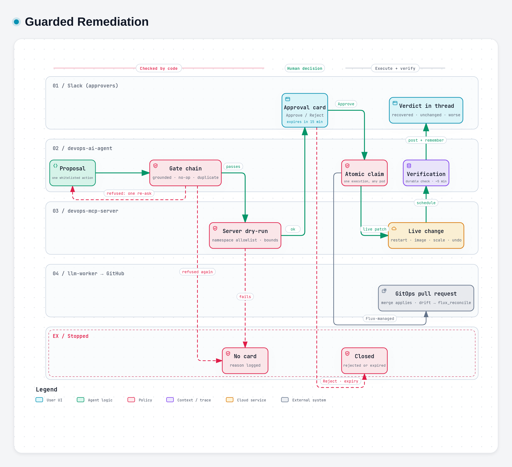

# Remediation and Safety Guardrails

> **Audience:** engineers, security reviewers and approvers. Parent: *DevOps AI Agent Stack — Overview*.

## The principle

**The model that investigates can never change anything.** A change happens only through a separate, narrowly typed proposal. That proposal must survive deterministic checks and a server-side dry-run, and then be approved in Slack by a named human. Every step is audited.

## Layered defences

*Diagram made with archify. Interactive version: `diagrams/remediation/remediation.html`; vector: `diagrams/remediation/remediation.svg`.*

## Whitelisted actions

| Action | When it is proposed | Extra guardrails |
|---|---|---|
| `k8s_rollout_restart` | A transient fault that a clean restart plausibly fixes | Refused when the pods are healthy, or when a restart cannot fix the cause (e.g. RBAC `forbidden`) |
| `k8s_set_image` | The image is wrong or missing **and** evidence names a working one, or a user asks for a specific tag | Never invents a tag; refused if no tool result shows the target image |
| `k8s_set_resources` | OOMKilled / resource exhaustion | Patches only the values given; an "OOM fix" that shrinks memory is refused |
| `k8s_scale` | Under-capacity | Bounded by `MAX_SCALE_DELTA`. Scale to zero is allowed only as a reversible **quarantine** of a workload that a capacity scan in the same thread listed as idle. |
| `k8s_delete_pod` | One pod is wedged while its siblings are healthy | Only controller-owned pods, which the controller recreates |
| `k8s_delete_orphan` | An object nothing references, found by a scan in the same thread | The manifest is **backed up** to Postgres and posted to the thread before the delete. The server re-checks provenance, ownership and age live. |
| `k8s_rollout_undo` | A bad rollout on the thread's change timeline | Gated on the timeline. The target revision is chosen by code, never by the model, and an Approve after the Deployment has moved is rejected atomically. |
| `flux_reconcile` | **Drift**: the cluster runs something other than what Git declares | Restores what Git declares |

There is deliberately **no generic delete or arbitrary patch**. Every action is reversible, or backed up before it runs.

## The gate chain

One chain (`refusalFor`) serves both production and the benchmark, so a test cannot pass a card that production would refuse. It contains these checks:
- placeholder or fabricated evidence;
- a proposal that asks the user for input;
- a replacement or no-op change (the image "change" is the image already running; a restart of healthy pods);
- the target kind is wrong;
- resource fault;
- unjustified scale-out;
- target not grounded in tool output;
- mismatch with what the agent offered;
- duplicate of an open card.

A refusal gets **one** re-ask that quotes the refusal, and the answer runs the whole chain again.

An alert firing is evidence enough to consider a fix. A casual mention is not: it proposes only when the reply is an RCA, the user asked for a change, or the answer contains real fault evidence.

## GitOps-managed workloads

On a Flux-managed workload, a direct patch would be reverted by the next reconcile, so:
- **Image or replica changes become a pull request** against the GitOps repo. The card shows the diff; *Approve* opens the PR; the merge applies it. The PR is opened by the llm-worker inside the private network, which holds the GitHub credentials.
- **Rollback becomes a revert PR** of the commit that introduced the bad change. It is refused unless the revert is clean.
- **Drift** (Git declares one value, the cluster runs another): the worker refuses the PR and the agent proposes `flux_reconcile` instead.
- Restarts and pod deletes stay allowed on GitOps workloads, because they are reconcile-safe.

## Verification and memory

After an execution, a verification check is written to Postgres. Any replica claims it when it is due, about 5 minutes later by default. It compares pod readiness and alert state, and posts a verdict into the thread:
- `recovered`;
- `unchanged`;
- `worse` (readiness dropped);
- `inconclusive`.

A **GitOps PR** changes nothing until it is merged and Flux syncs it, so its check waits first. The agent re-reads the workload every minute until it runs what the PR set (the new image, or the new replica count), then takes the baseline and runs the same verification. If the change is not running 24 hours after the PR, the check closes as *not applied*, without a verdict. Revert PRs are not watched yet.

The verdict is remembered, so the next occurrence of the same alert sees "this fix was tried and the alert stayed up". Cards nobody clicks are expired, and their message is updated so a stale *Approve* button never lingers.

## Access control

| Who | Can do |
|---|---|
| `SLACK_ALLOWED_USERS` (plus on-call and approvers; empty = anyone in the bot's channels) | Mention the agent, ✅-learn |
| `SLACK_APPROVER_USERS` (fallback: on-call users) | Approve or reject remediation cards |
| `SLACK_ONCALL_USERS` | Paged automatically on Low-confidence RCAs |
| Alertmanager | `POST /alert` with the shared `ALERT_WEBHOOK_TOKEN` |
| Agent → MCP server | Shared `MCP_AUTH_TOKEN` bearer token |
| Dashboard viewers | One shared password exchanged for a signed cookie. Read-only. Reached by port-forward, or through the chart's optional Ingress. |

## Data protection

- **Identifier masking.** Before any request reaches an LLM backend, hosted or private, IPs, emails, AWS ARNs and account IDs, and public hostnames are replaced with stable tokens. The tokens are restored in the reply. Workload and namespace names are kept, because the model reasons with them.
- **Secrets are never read.** The tool `k8s_list_secrets` returns names and types only. The MCP server never returns environment variable values, only their names.
- **The agent holds no GitHub credentials.** They live only in the llm-worker inside the private network.
- **Cluster text is data.** Instruction-like text inside logs, events or annotations is framed as untrusted data before it reaches the model.
- **The dashboard escapes everything.** RCA text is LLM output, so every value is escaped and a strict Content Security Policy applies; only the two map pages run a script, with a per-response nonce.

## What is not a guarantee

- Masking and injection framing are **pattern-based**. They reduce exposure; the real security boundary is still the write-tool isolation, the dry-run and the human approval click.
- The agent's RCA is a **hypothesis with evidence**, not a verdict. The confidence level and the grounding warnings say how much to trust it.
