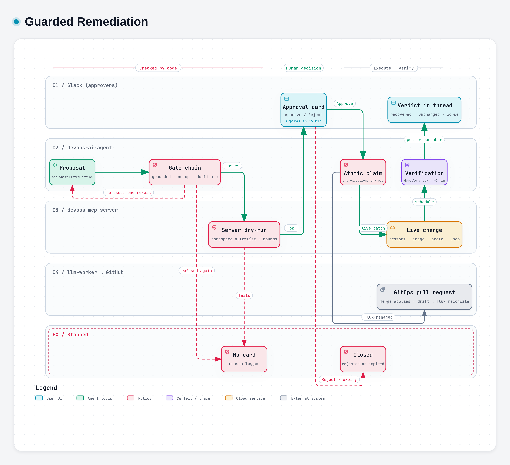

# Remediation and Safety Guardrails

> **Audience:** engineers, security reviewers and approvers. Parent: *DevOps AI Agent Stack — Overview*.

## The principle

**The model that investigates can never change anything.** A change happens only through a separate, narrowly typed proposal. That proposal must survive deterministic checks and a server-side dry-run, and then be approved in Slack by a named human. Every step is audited.

## Layered defences

No single check is trusted on its own. A change has to get past code, a human and a verification, in that order:

*Diagram made with archify. Interactive version: `diagrams/remediation/remediation.html`; vector: `diagrams/remediation/remediation.svg`.*

A fix passes through three layers, and any one of them can stop it:

1. **Checked by code.** The model proposes **one** action from the whitelist below. The gate chain checks it against the evidence in the thread; a refused proposal produces no card, and the reason is logged. Next, the MCP server runs the action as a **dry-run**: the namespace must be on the allowlist and the change within its bounds, and Kubernetes validates it without applying it.
2. **Human decision.** Only a proposal that survived the code checks becomes an **approval card** in Slack. A named approver clicks *Approve* or *Reject* within 15 minutes, otherwise the card closes as expired.
3. **Execute and verify.** *Approve* is claimed atomically, so a double click or a second replica can never run the change twice. A live change is applied directly. On a Flux-managed workload the change becomes a **pull request** instead, and drift becomes a `flux_reconcile`. About 5 minutes after the change runs, a durable check posts the **verdict** into the thread.

## Whitelisted actions

These are the only twelve changes the agent can ever propose. Each is a typed write tool (`vm_restart_service` is the agent's own, served to the VM it names), not a free-form command:

| Action | When it is proposed | Extra guardrails |
|---|---|---|
| `k8s_rollout_restart` | A transient fault that a clean restart plausibly fixes | Refused when the pods are healthy, or when a restart cannot fix the cause (e.g. RBAC `forbidden`) |
| `k8s_set_image` | The image is wrong or missing **and** evidence names a working one, or a user asks for a specific tag | Never invents a tag; refused if no tool result shows the target image |
| `k8s_set_resources` | OOMKilled / resource exhaustion | Patches only the values given. An "OOM fix" that lowers the memory limit, keeps it, or raises it by less than the capacity tool recommends for a killed container is refused |
| `k8s_scale` | Under-capacity | Bounded by `MAX_SCALE_DELTA`. Scale to zero is allowed only as a reversible **quarantine** of a workload that a capacity scan in the same thread listed as idle. |
| `k8s_delete_pod` | One pod is wedged while its siblings are healthy | Only controller-owned pods, which the controller recreates |
| `k8s_cordon` / `k8s_uncordon` | A node that is itself failing (NotReady, a pressure condition, a disk or I/O fault), or a cordoned node whose fault is gone | Refused for a control-plane node and for the cluster's last schedulable node. Cordon only stops new pods landing; running pods stay. |
| `k8s_drain` | The same node evidence, when its running pods must move | Cordon, then evict through the Eviction API: a pod protected by a PodDisruptionBudget is reported **blocked**, never deleted. DaemonSet, static and finished pods stay, and so does a pod whose volume exists only on that node (a `local-path` volume): it is reported **pinned**, because evicted it would wait Pending until the node is uncordoned. Same refusals as cordon, plus one: refused when the evicted pods' resource requests cannot fit on the other schedulable nodes. Every check runs before the node is cordoned, so a refused drain changes nothing. |
| `vm_restart_service` | A VM incident (the alert's `hostname` names a VM running `devops-vm-agent`) whose evidence shows one of its units wedged | The VM pulls the approved action and runs `systemctl restart` **only** for a unit in its own local allowlist; anything else it reports as refused. Per-VM token; an action not picked up in 15 minutes expires. No other VM action exists. |
| `k8s_delete_orphan` | An object nothing references, found by a scan in the same thread | The manifest is **backed up** to Postgres and posted to the thread before the delete. The server re-checks provenance, ownership and age live. |
| `k8s_rollout_undo` | A bad rollout on the thread's change timeline | Gated on the timeline. The target revision is chosen by code, never by the model, and an Approve after the Deployment has moved is rejected atomically. |
| `flux_reconcile` | **Drift**: the cluster runs something other than what Git declares | Restores what Git declares |

There is deliberately **no generic delete, arbitrary patch or remote shell**. Every action is reversible, or backed up before it runs.

## The gate chain

Every proposal is checked by code before a card can appear. One chain (`refusalFor`) serves both production and the benchmark, so a test cannot pass a card that production would refuse.

**Before the chain**, the proposal itself must be well formed. A proposal is rejected when it holds a placeholder such as `namespace="X"`, or when it asks the user for input instead of naming a target.

**The chain**, in the order the checks run:

| Check | What it refuses | Skipped for a human's own request? |
|---|---|---|
| **Kind** | A target named with the wrong kind, for example a ReplicaSet or a StatefulSet proposed as a Deployment. It runs first, because every later check reads the spec by kind. | No |
| **Replacement and no-op** | A restart or pod delete that cannot help: the pods are healthy and nothing names them as the fault, the restart is argued from a failing probe while every pod is Ready with zero restarts, the kubelet has already restarted them many times, or the error is RBAC `forbidden`. Also a change that changes nothing: the image already running, or the resources already configured. And a memory limit for an OOMKilled container below the limit-based number from `k8s_recommend_resources` — usage read before a kill is capped by the limit, so it is not the peak. | Yes |
| **Quarantine** | A scale to zero of a workload that no capacity scan in this thread measured as idle | No |
| **Orphan** | A delete of an object that no unused-resource scan in this thread listed as an orphan | No |
| **Rollback** | A rollback with no matching change on the thread's change timeline. The target revision is chosen by code, never by the model. | No |
| **Offer** | A proposal that acts on a different object from the one the agent offered and the user agreed to | No |
| **Target** | A target that appears in no tool result and no alert label, so it was invented rather than found | No |
| **Resource fault** | A resize with no resource fault (OOMKill, throttling, insufficient CPU or memory) on the target's own lines of evidence | Yes |
| **Scale** | A scale-out with no measured saturation of that workload (throttling, backlog, pending pods) | Yes |
| **Image** | An image that no tool result in the thread showed, and that nobody asked for by name | No |

**After the chain**, two more checks run. A proposal that duplicates a card still open for the same incident is dropped. Then comes the MCP server's dry-run.

A refusal gets **one** re-ask that quotes the refusal, and the answer runs the whole chain again. If the re-ask is refused too, there is no card. The refusal is posted in the thread only when a human asked for the change; when the model proposed it, the refusal is logged and noted for follow-up questions.

An alert firing is evidence enough to consider a fix. A casual mention is not: it proposes only when the reply is an RCA, the user asked for a change, or the answer contains real fault evidence.

## GitOps-managed workloads

On a Flux-managed workload, a direct patch would be reverted by the next reconcile, so:
- **Image or replica changes become a pull request** against the GitOps repo. The card shows the diff; *Approve* opens the PR; the merge applies it. The PR is opened by the llm-worker inside the private network, which holds the GitHub credentials.
- **Rollback becomes a revert PR** of the commit that introduced the bad change. It is refused unless the revert is clean.
- **Drift** (Git declares one value, the cluster runs another): the worker refuses the PR and the agent proposes `flux_reconcile` instead.
- Restarts and pod deletes stay allowed on GitOps workloads, because they are reconcile-safe.

## Verification and memory

After an execution, a verification check is written to Postgres. Any replica claims it when it is due, about 5 minutes later by default. It compares pod readiness and alert state, and posts a verdict into the thread:
- `recovered`;
- `unchanged`;
- `worse` (readiness dropped);
- `inconclusive`.

A **GitOps PR** changes nothing until it is merged and Flux syncs it, so its check waits first. The agent re-reads the workload every minute until it shows every value the PR set — the new image, replica count or resources, or, for a revert PR, the values the broken rollout had changed — then takes the baseline and runs the same verification. If the change is not running 24 hours after the PR, the check closes as *not applied*, without a verdict.

The verdict is remembered, so the next occurrence of the same alert sees "this fix was tried and the alert stayed up". Cards nobody clicks are expired, and their message is updated so a stale *Approve* button never lingers.

## Access control

Who may do what, and how each party proves it:

| Who | Can do |
|---|---|
| `SLACK_ALLOWED_USERS` (plus on-call and approvers; empty = anyone in the bot's channels) | Mention the agent, ✅-learn |
| `SLACK_APPROVER_USERS` (fallback: on-call users) | Approve or reject remediation cards |
| `SLACK_ONCALL_USERS` | Paged automatically on Low-confidence RCAs |
| Alertmanager | `POST /alert` with the shared `ALERT_WEBHOOK_TOKEN` |
| Agent → MCP server | Shared `MCP_AUTH_TOKEN` bearer token |
| Dashboard viewers | One shared password exchanged for a signed cookie. Read-only. Reached by port-forward, or through the chart's optional Ingress. |

## Data protection

What leaves the cluster, and in what form:

- **Identifier masking.** Before any request reaches an LLM backend, hosted or private, IPs, emails, AWS ARNs and account IDs, and public hostnames are replaced with stable tokens. The tokens are restored in the reply. Workload and namespace names are kept, because the model reasons with them.
- **Secret values are masked at the source.** The tool `k8s_list_secrets` returns names and types only. Every other tool result is masked inside the MCP server before it leaves the cluster: env values whose name ends in a secret word (`DB_PASSWORD`, `API_TOKEN`), the value after `--token` or `--password` in container args, and token-shaped text (JWTs, base64 tokens, Bearer headers, AWS key ids, passwords in URLs). Names and references (`secretName`, `secretKeyRef`) are kept.
- **The agent holds no GitHub credentials.** They live only in the llm-worker inside the private network.
- **Cluster text is data.** Instruction-like text inside logs, events or annotations is framed as untrusted data before it reaches the model.
- **The dashboard escapes everything.** RCA text is LLM output, so every value is escaped and a strict Content Security Policy applies; only the two map pages run a script, with a per-response nonce.

## What is not a guarantee

- Masking, secret redaction and injection framing are **pattern-based**. They reduce exposure, but a secret in an unusual shape can still get through. The real security boundary is still the write-tool isolation, the dry-run and the human approval click, and secrets belong in Kubernetes Secrets, not in plain args or env values.
- The agent's RCA is a **hypothesis with evidence**, not a verdict. The confidence level and the grounding warnings say how much to trust it.
